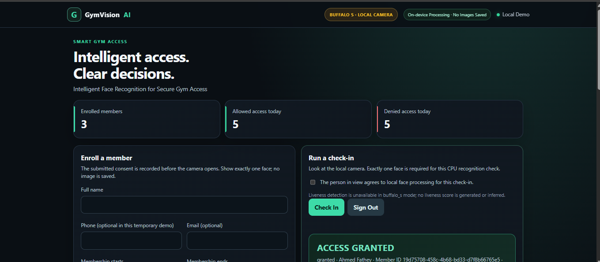
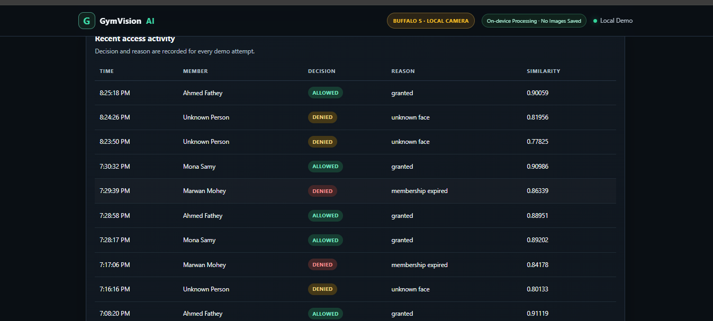
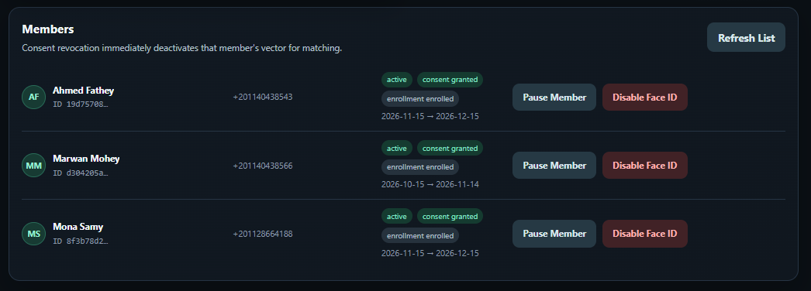

# GymVision AI MVP

Local-first gym access prototype with two explicit recognition modes:

- `simulated` (default): synthetic vectors and an operator-entered demo score. This is a UI/API demonstration only.
- `buffalo_s`: local CPU face detection and embedding extraction from the named DroidCam Video device through PyAV/DirectShow. Camera frames stay in memory, are returned only to the local dashboard preview, and are not written to disk or sent to external services. Face templates are stored as normalized 512-dimensional embeddings; member, consent, membership, and access-event data are also stored by the selected storage backend.

The app includes both a PostgreSQL store and an in-memory demo store. PostgreSQL mode uses the repository schema and `VECTOR(512)` embeddings; the app does not create the database or apply schema/migrations automatically. For safety, the PostgreSQL store refuses to connect unless `GYMVISION_DATABASE_URL` targets `gymvision_ai_test`.

## Setup

Use Windows and Python with the project virtual environment. If `.venv` does not exist yet, create it from the project root:

```powershell
python -m venv .venv
```

Copy `.env.example` to `.env` and set local admin credentials. The example config selects PostgreSQL storage and targets `gymvision_ai_test`; set the URL to your local PostgreSQL login. Before using PostgreSQL mode, create that test database and apply the repository SQL schema/migrations separately. Never point this prototype at `gymvision_ai`.

Install the dependencies listed in `requirements.txt` into `.venv`:

```powershell
.\.venv\Scripts\python.exe -m pip install -r requirements.txt
```

Start the API and dashboard:

```powershell
.\.venv\Scripts\python.exe -m uvicorn backend.app:app --reload
```

Open `http://127.0.0.1:8000`. The default mode remains simulated unless `GYMVISION_RECOGNITION_MODE` is set to `buffalo_s` in `.env` or the shell.

## Screenshots

These supplied screenshots contain synthetic demo data, as confirmed by the project owner.








## Isolated competition demo (no database)

For the local 2–3 person competition demo, run the API with the existing in-memory store. In this mode it does not connect to PostgreSQL; member records, consent state, embeddings, and access events exist only until the API process stops. The store enforces a three-member limit. In PowerShell:

```powershell
$env:GYMVISION_RECOGNITION_MODE = "buffalo_s"
$env:GYMVISION_DEMO_STORAGE = "memory"
$env:GYMVISION_SIMILARITY_THRESHOLD = "0.82"
.\.venv\Scripts\python.exe -m uvicorn backend.app:app --host 127.0.0.1 --port 8000
```

The similarity threshold compares face embeddings (cosine similarity); it is separate from the detector confidence threshold of 0.50. The admin credentials still come from `.env`.

## Simulated mode

Set:

```text
GYMVISION_RECOGNITION_MODE=simulated
```

Enroll a member with the demo consent checkbox. The UI creates a synthetic vector locally through the API, and check-in compares synthetic vectors. Its liveness score is manually entered and is not liveness detection.

## Buffalo S mode

Set:

```text
GYMVISION_RECOGNITION_MODE=buffalo_s
```

The model pack must already exist locally. Obtain the full Buffalo_S pack through the [official InsightFace releases](https://github.com/deepinsight/insightface/releases) and follow the [official model installation guidance](https://github.com/deepinsight/insightface/blob/master/python-package/docs/model_zoo.md); follow the applicable model license. The default model root is `%USERPROFILE%\.insightface`; the required files are expected at `%USERPROFILE%\.insightface\models\buffalo_s\det_500m.onnx` and `w600k_mbf.onnx`. To use another root, set `GYMVISION_INSIGHTFACE_ROOT`. The application checks for the local files and will not download weights. It initializes `FaceAnalysis` explicitly with `name="buffalo_s"` and `CPUExecutionProvider`. Do not commit or redistribute model weights unless their license permits it.

Enrollment records the submitted consent and pending member before opening the camera. It then captures one frame, requires exactly one face, and stores only its normalized 512-dimensional embedding with model version `buffalo_s-512-v1`. If capture fails, the member stays in `failed` enrollment state with the consent record intact; the dashboard provides a retry action while consent remains valid.

Real-mode check-in captures one frame and performs cosine matching only against active, consented embeddings with the same model version. Access is granted only if the matched member is active and has a current active membership. Revoked consent blocks matching. Liveness detection is **unavailable**: real-mode logs leave `liveness_score` empty and the UI does not show or use the simulated score. This prototype is not suitable for unattended physical access control.

The webcam is opened by the local API process using PyAV/DirectShow and the exact device name `DroidCam Video`; run the API on the same Windows computer as the webcam. Buffalo S uses 320×320 detector input and a 0.50 detector confidence threshold for this demo. Identity matching uses a separate cosine similarity threshold, configurable with `GYMVISION_SIMILARITY_THRESHOLD` (default `0.82`). Do not treat detector confidence as identity similarity.

## Model license

InsightFace code and pretrained weights have different licenses. InsightFace states that its public pretrained models, including Buffalo S, are for non-commercial research; commercial use requires separate authorization. This implementation is a non-commercial competition prototype and is not commercially cleared. Review the [official InsightFace model licensing information](https://github.com/deepinsight/insightface/blob/master/python-package/docs/model_zoo.md) and the terms that came with the specific model files before redistribution or use. Obtain separate written authorization or appropriately licensed weights before commercial use.

## Verification

Run the automated tests:

```powershell
.\.venv\Scripts\python.exe -m pytest -q
```

Automated tests mock the recognition model and camera; they do not open the camera or capture face images. Camera smoke tests are manual-only scripts and open the camera only when explicitly run as scripts.
